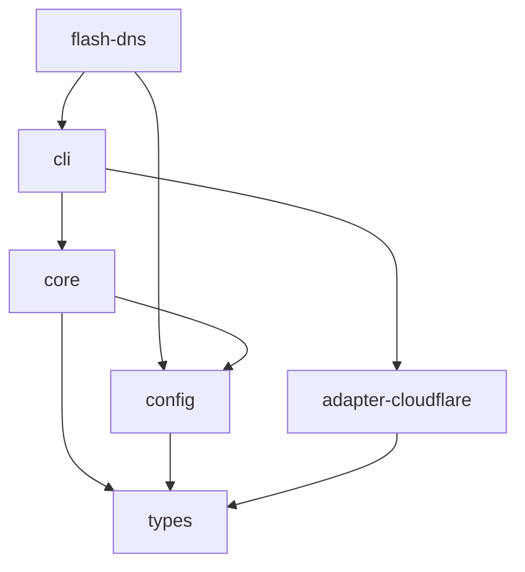

# 02 · Monorepo 与模块边界

## 包结构（建议）

```text
flash-dns/
├─ packages/
│  ├─ flash-dns/             包名 flash-dns：bin、用户配置导出、默认入口
│  ├─ cli/                   @flash-dns/cli：命令、交互、展示、装配
│  ├─ core/                  @flash-dns/core：命名、协调、归属、结果
│  ├─ config/                @flash-dns/config：配置类型、defineConfig
│  ├─ types/                 @flash-dns/types：适配器契约、记录类型、错误
│  └─ adapter-cloudflare/    @flash-dns/adapter-cloudflare：服务商实现
├─ scripts/
│  └─ build.common.ts
├─ ai-docs/design-docs/
├─ eslint.config.ts
├─ tsconfig.json
├─ vitest.config.ts
├─ pnpm-workspace.yaml
└─ package.json
```

作用域暂按 `@flash-dns` 设计；实际发布前核对用户创建的 npm 组织和权限。

## 职责与依赖

| 包 | 负责 | 不负责 |
| --- | --- | --- |
| types | 记录、适配器、能力、公共错误和上下文类型 | 读配置、请求网络、读取环境变量 |
| config | defineConfig 和用户配置契约 | 创建服务商、执行 DNS 变更 |
| core | 配置解析、命名、计划、协调、归属校验 | 终端 UI、服务商 API 细节 |
| adapter-cloudflare | API 请求、Zone、分页、记录映射、元数据映射 | CLI 交互、会话和 Tunnel 生命周期 |
| cli | 参数解析、适配器加载、命令、交互、输出 | 在命令中重新实现协调算法 |
| flash-dns | 薄 bin 包装和面向用户的配置导出 | 承载核心业务代码 |



核心库不得反向依赖 CLI 或 Cloudflare 适配器。适配器之间不相互依赖。仅安装 `@flash-dns/core` 不应引入 Cloudflare 实现、spinner 或 prompts。

小工具函数先放在所属包内部，不预先增加 utils 包。稳定且跨包重复的能力出现后再抽取。

## 核心模块（建议）

```text
core/src/
  config/          加载、优先级、来源追踪、运行时校验
  naming/          项目名、变量、模板、hostname 校验
  ownership/       稳定 owner、记录归属及删除检查
  reconcile/       计划生成、变更执行、结果确认
  manager.ts       createDnsManager
  errors.ts
  index.ts
```

`core` 接收已经装配好的适配器实例。SDK 使用方可显式传入全部上下文，绕过文件发现和项目自动探测。

## 装配与副作用

- CLI 入口把环境变量、配置和参数解析为显式选项，再创建适配器。
- 适配器接受 `apiToken`、`fetcher` 等构造参数，不自行遍历配置或读取项目环境。
- import 任意包不应发送请求、创建记录、注册退出清理或启动子进程。
- logger、AbortSignal、时间和随机值来源可注入，便于测试和嵌入。
- 工具默认不持有常驻进程；一次命令完成后退出。

## 打包入口

- 用户入口提供 bin，配置从 `flash-dns` 或 `flash-dns/config` 导入。
- flash-tunnel 直接依赖 `@flash-dns/core`、`@flash-dns/adapter-cloudflare`，按需使用 config/types。
- 包输出 ESM 和声明文件，包间使用 `workspace:*`。
- 公共导出采用显式 exports，调用方不导入未承诺稳定的内部文件。
- 不发布根 workspace 包，根包设置 `private: true`。
