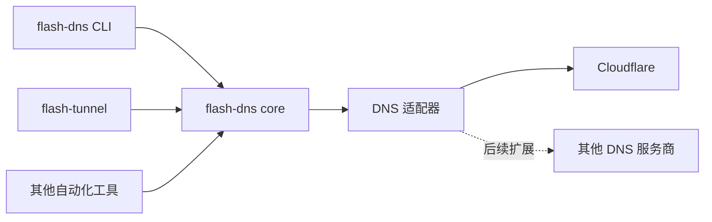

# flash-dns 设计文档

记录本轮讨论已经确认的产品边界、架构和工程规范，作为后续实现的依据。

- 项目目录：`D:\Projects\flash-dns`
- 目标仓库：`git@github.com:flash-tunnel/flash-dns.git`
- 用户已创建 flash-dns 包及组织；具体 npm 作用域、发布权限在接入发布前核对。
- 当前阶段：已实现首版独立 CLI / SDK、Cloudflare 适配器及离线测试；尚未发布或配置真实 DNS。实际接口和验证记录见 [项目 README](../../README.md) 与 [开发报告](../implementation-report.md)。
- 文档日期：2026-10-22。

## 阅读顺序

| 文档 | 内容 |
| --- | --- |
| [01-product.md](./01-product.md) | 产品定位、职责边界、使用场景、首版范围 |
| [02-architecture.md](./02-architecture.md) | Monorepo、包职责、依赖方向、适配器装配 |
| [03-naming-configuration.md](./03-naming-configuration.md) | 项目名标准化、域名模板、配置加载 |
| [04-adapter-contracts.md](./04-adapter-contracts.md) | 服务商适配器、记录模型、能力和错误契约 |
| [05-reconciliation-ownership.md](./05-reconciliation-ownership.md) | 幂等协调、冲突、资源归属、并发及删除 |
| [06-cli-sdk.md](./06-cli-sdk.md) | CLI 命令、SDK 使用、日志及退出码 |
| [07-cloudflare-flash-tunnel.md](./07-cloudflare-flash-tunnel.md) | Cloudflare 实现、现有代码复用、flash-tunnel 接入 |
| [08-engineering-release.md](./08-engineering-release.md) | 开发规范、构建、hooks、发布检查 |
| [09-testing-roadmap.md](./09-testing-roadmap.md) | 测试重点、实现顺序、验收条件 |
| [checklist.md](./checklist.md) | 实施进度清单和待确认事项 |

## 已确认的决定

1. 项目名为 **flash-dns**，独立于 Slidev 和具体部署系统。
2. 根据项目名或可配置规则生成域名，通过适配器管理 DNS 记录。
3. `@org-name/project-name` 默认转换为 `org-name-project-name`。
4. 使用 monorepo，同时提供 CLI 和可编程核心库。
5. 首个服务商为 Cloudflare，未来能够增加其他适配器。
6. flash-tunnel 将来可以只引入 SDK，替换其现有 DNS 实现。
7. 不由 DNS 库管理 Tunnel、应用进程、证书、SSH、Nginx 或文件部署。
8. 开发风格参考 `D:\Projects\flash-tunnel`，包含 antfu ESLint、nano-staged、simple-git-hooks、unbuild 和 Vitest。
9. 发布前纳入用户指定的 publish-checklist 检查，并增加 CLI 打包入口验证。

## 文档约定

- “已确认”表示用户明确接受的边界或要求。
- 包拆分、接口名称、配置字段和退出码为**实现建议**；当前示例不是已可运行的 API。
- 许可证已由用户选择 MIT；发布认证和组织权限单独记录，不填写猜测值。
- 设计变更同步更新相关文档及清单，避免将已放弃的部署职责带回核心库。

## 与其他项目的关系

原始需求中的 `project-name.slidev.acewill.dev` 是一个使用案例。后续部署系统可以调用 flash-dns 准备域名，但构建和部署流程不属于本项目。
